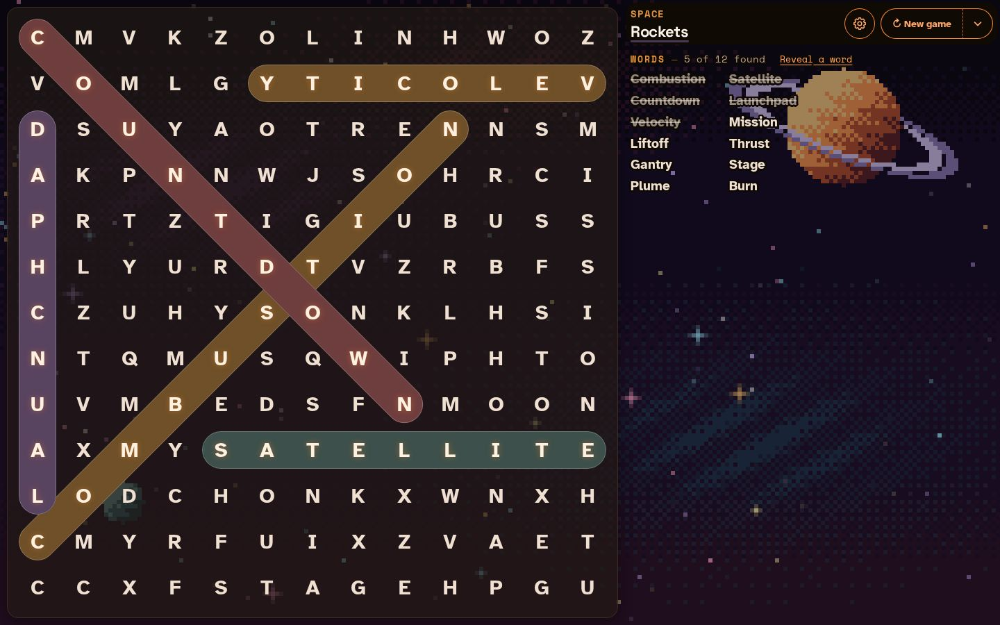
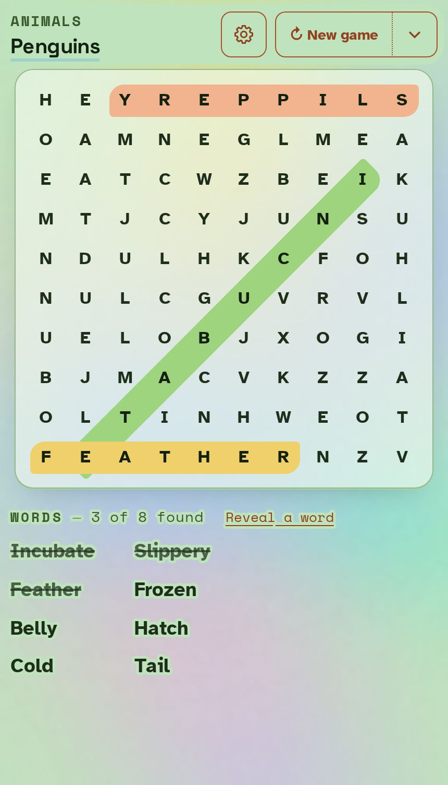
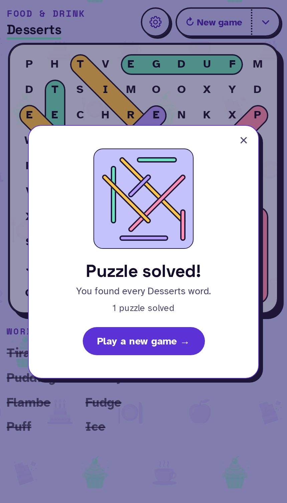
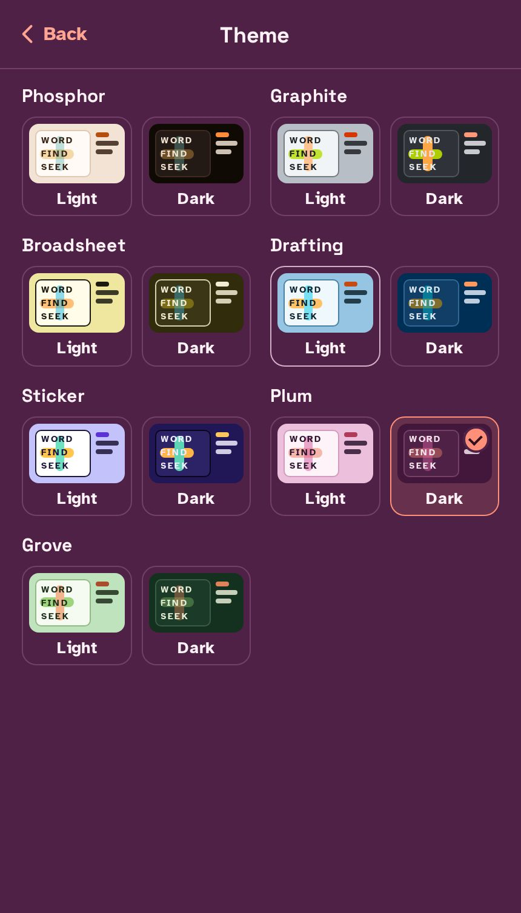
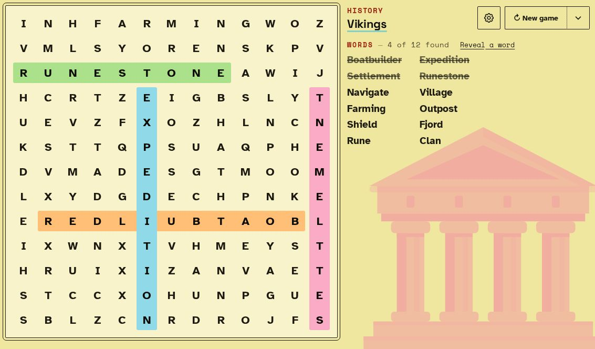

<h1 align="center">Word Finder</h1>

<p align="center">
  A colourful word search for phone, iPad and laptop. Free, no ads, and it works offline.
  <br><br>
  <a href="https://beeberbab.github.io/word-finder/"><b>▶&nbsp; Play it now</b></a>
</p>

<p align="center">
  
</p>

## What it is

Every puzzle is about one subject, from penguins and desserts to Vikings and rockets.
Pick one of 25 categories, or let the game choose, and you get a fresh grid with words
hidden across, down, diagonally and backwards. Drag across a word to find it.

<table>
  <tr>
    <td align="center"><br><sub>On an iPhone</sub></td>
    <td align="center"><br><sub>Puzzle solved</sub></td>
    <td align="center"><br><sub>Seven themes, light or dark</sub></td>
  </tr>
</table>

## Features

- **600 subjects in 25 categories.** Each subject has its own word list, and the game
  steers you towards subjects and words you haven't seen yet, so it keeps feeling new.
- **Levels and points.** Sign in with a username and password to play an endless run of
  levels on easy, normal or hard. Points add up for each word, for streaks and for speed,
  and your progress follows you to any device. Random play never needs an account.
- **Art for every subject.** Each subject gets its own animated scene of its icons, behind
  the whole screen, in one colour or in full colour. Or choose another animated background such as Aurora,
  Galaxy or Koi.
- **Seven themes**, each in a light and a dark version, all checked for readable
  contrast.
- **Made for touch.** The board sizes itself to your screen, with a 10×10 grid on
  phones and 13×13 on bigger screens, and every button is easy to tap.
- **Installable and offline.** After your first visit it plays with no connection.

<p align="center">
  
  <br><sub>On an iPad in landscape</sub>
</p>

## Install it

Open **[beeberbab.github.io/word-finder](https://beeberbab.github.io/word-finder/)**, then:

- **iPhone or iPad:** tap Share, then **Add to Home Screen**.
- **Chrome or Edge on a laptop:** click the install icon in the address bar.

## Accounts and privacy

Accounts are optional and only used for levels. Your password goes straight to Firebase
Authentication and is never stored by the game. Your level progress is kept in one
record that only your account can read or change. Random play keeps everything on your
device.

## Under the hood

Word Finder is plain HTML, CSS and JavaScript served straight from this repository by
GitHub Pages: no build step, no frameworks and no server. A service worker keeps it
working offline.

- [docs/development.md](docs/development.md) has the file-by-file map, the tests, how to
  add a subject, and how to set up accounts.
- [CLAUDE.md](CLAUDE.md) explains how to work on the project safely.

The subject icons are Microsoft's [Fluent Emoji](https://github.com/microsoft/fluentui-emoji),
used under the MIT licence.

```bash
npm ci && npx playwright install chromium
npm test        # unit and end-to-end tests against a local server
```
